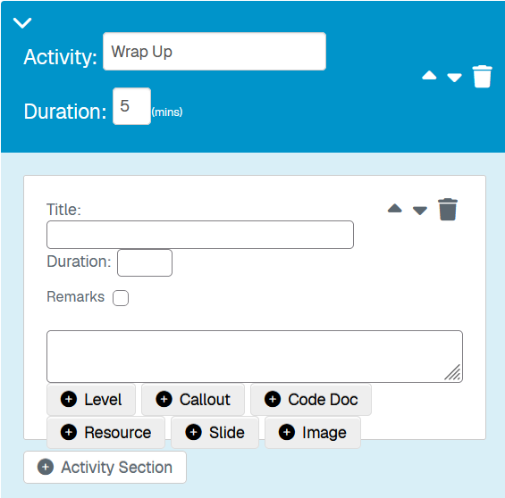
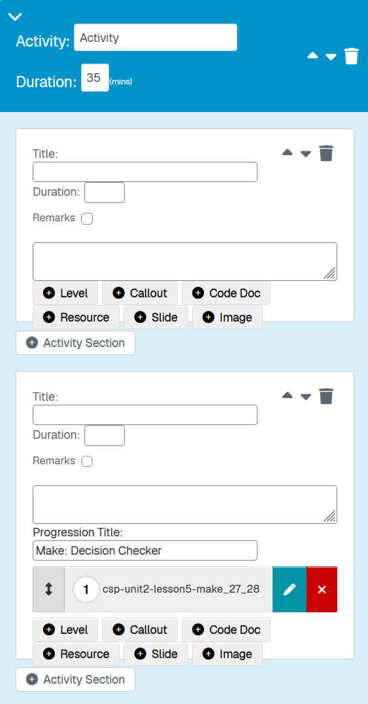
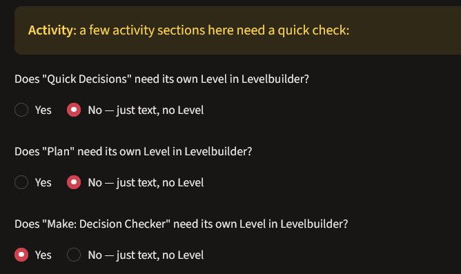
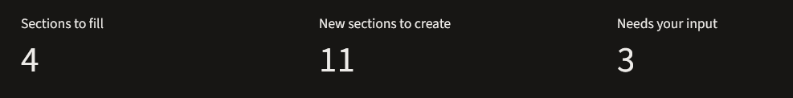
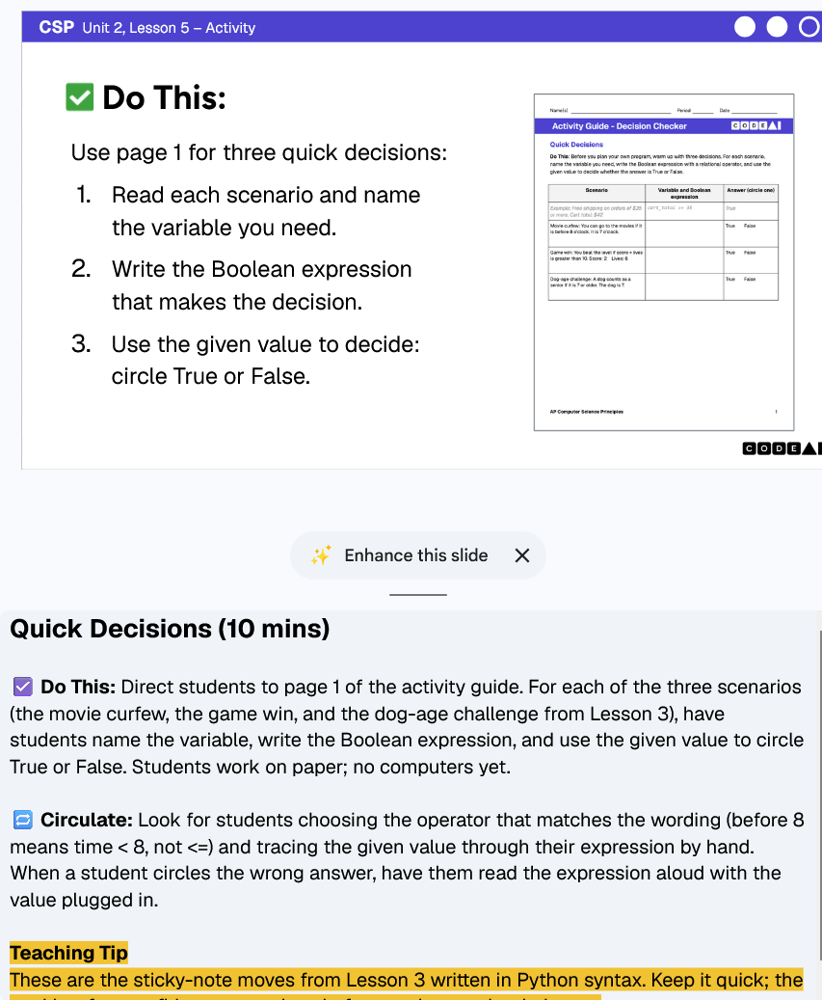
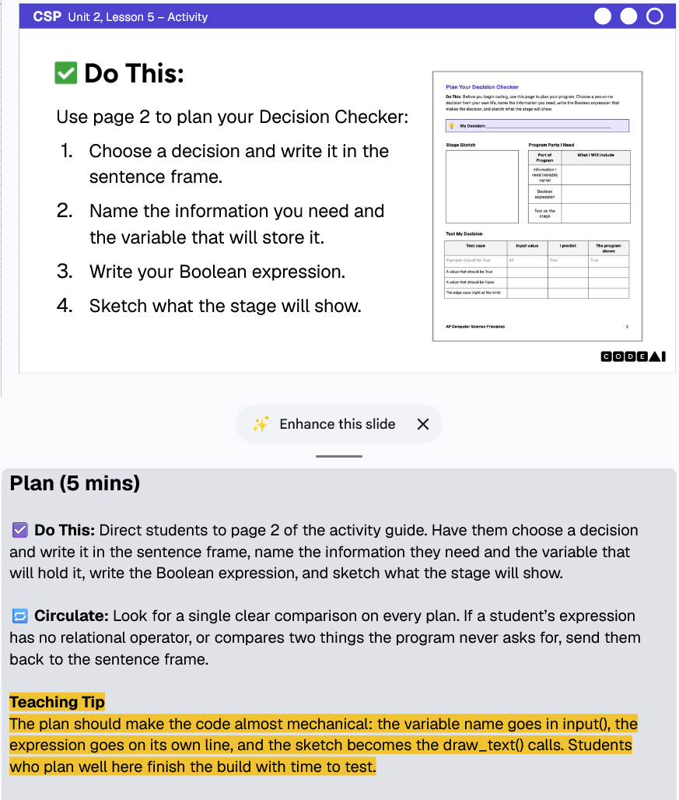
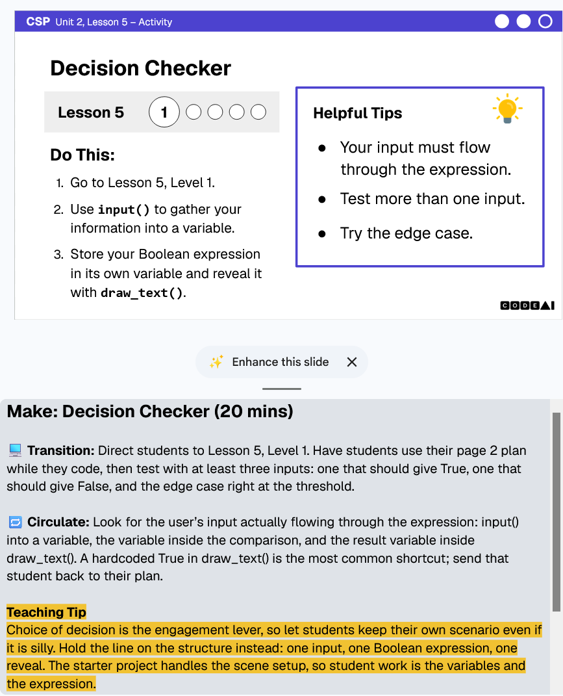

# Levelbuilder Speaker Notes Tool

A Streamlit app that reads the speaker notes out of a Google Slides lesson
deck and writes them into the matching fields on a Code.org Levelbuilder
lesson edit page — so you don't have to copy/paste each section by hand.

It supports both a standard single lesson (Warm Up / Activity / Wrap Up)
and a Multi-Day Project (Connect Task-style lessons spanning several
"Day N" blocks in Levelbuilder). It never clicks Save — it leaves a
browser window open at the end for you to review and save yourself.

This tool isn't specific to any one course's curriculum — anyone on the
team working with Levelbuilder lessons that follow the same Warm Up /
Activity / Wrap Up speaker-notes convention can use it.

---

## What you need before you start

You only need to do this setup once per computer:

1. **Python 3.9 or newer**
2. **A Google Cloud OAuth client** (so the tool can read your Google Slides
   deck and its slide images on your behalf) — a one-time ~10 minute setup,
   walked through below.
3. **A Code.org Levelbuilder login** — no special setup needed, the tool
   opens a real browser window for you to log in the first time and
   remembers that session afterward.

---

## 1. Install Python

### Windows
Check if you already have it by opening **PowerShell** and running:
```powershell
python3 --version
```
If it says Python wasn't found, it will offer to open the Microsoft Store —
install Python from there, then re-open PowerShell.

### Mac
Macs don't ship with Python 3 pre-installed. Open **Terminal** (Spotlight
search → type "Terminal") and check first:
```bash
python3 --version
```
If that fails, the easiest route is [Homebrew](https://brew.sh):
```bash
# Install Homebrew first if you don't have it (one-time):
/bin/bash -c "$(curl -fsSL https://raw.githubusercontent.com/Homebrew/install/HEAD/install.sh)"

# Then install Python:
brew install python3
```
Everything else in this README works identically in Terminal on a Mac as
it does in PowerShell on Windows — just run the commands in Terminal
instead.

---

## 2. Download this repo

Click the green **Code** button on this repo's GitHub page → **Download ZIP**
(or `git clone` it if you're comfortable with git) and unzip it somewhere
on your computer, e.g. `Documents/levelbuilder-tool/`.

Open a terminal (PowerShell on Windows, Terminal on Mac) and navigate into
that folder:
```bash
cd path/to/levelbuilder-tool
```

---

## 3. Install the Python packages this tool needs

```bash
pip install --upgrade pip
pip install streamlit playwright python-pptx google-api-python-client google-auth-oauthlib google-auth
playwright install firefox
```

(On some systems you may need `pip3` instead of `pip`, or add
`--break-system-packages` if pip refuses to install outside a virtual
environment.)

---

## 4. Set up Google OAuth credentials (one-time, ~10 minutes)

This lets the tool download your Slides deck and fetch slide thumbnails on
your behalf. You only need to do this once — after the first login, it
reuses a saved session.

1. Go to the [Google Cloud Console](https://console.cloud.google.com/).
2. Create a new project (top-left project dropdown → **New Project**) —
   name it anything, e.g. "Levelbuilder Tool".
3. In the left sidebar, go to **APIs & Services → Library**. Search for and
   **Enable** each of these two APIs:
   - **Google Drive API**
   - **Google Slides API**
4. Go to **APIs & Services → OAuth consent screen**.
   - User type: **External** (unless your account is on a Google
     Workspace org that allows Internal).
   - Fill in the required fields (app name, your email) — you can leave
     most fields blank/default.
   - On the **Scopes** step, you can skip adding scopes manually — the
     tool requests them directly.
   - On the **Test users** step, add your own Google account email.
   - Save through to the end.
5. Go to **APIs & Services → Credentials** → **Create Credentials** →
   **OAuth client ID**.
   - Application type: **Desktop app**
   - Name it anything, e.g. "Levelbuilder Tool Desktop"
   - Click **Create**, then **Download JSON**.
6. Rename the downloaded file to **`credentials.json`** and place it in
   the same folder as `app.py`.

That's it for setup — `token.json` (the saved login session) gets created
automatically the first time you run the tool and log in.

---

## 5. Run the tool

From the tool's folder:
```bash
streamlit run app.py
```
This opens the app in your browser (usually `http://localhost:8501`).

**The first time** you Analyze a deck, two browser logins will pop up in
turn:
- A **Google** login/consent window (for the Slides URL) — log in and
  approve access. This is saved to `token.json` for next time.
- A **Levelbuilder** login window — log in there and navigate to the
  lesson page; the tool picks it up automatically. This is saved to
  `levelbuilder_session.json` for next time.

You won't see either of these again on future runs unless a session
expires or Google asks for a broader permission later (rare — the tool
handles that automatically by re-opening the login window once).

---

## 6. Using the tool

1. **Before anything else**, open the lesson's Levelbuilder edit page
   yourself and make sure the structure the tool expects already
   exists — the tool fills in and adds *content*, it doesn't create
   these top-level pieces for you:
   - **Single Lesson**: a **Warm Up**, **Activity**, and **Wrap Up**
     block already present (even if currently empty).
   - **Multi-Day Project**: each **Day N** block already present, and
     inside each one, a plain divider section titled exactly **Warm
     Up**, **Activity**, and **Wrap Up** (with no Levels attached yet).

   If any of these are missing, create them in Levelbuilder first. If
   you skip this step, the tool won't guess — it'll stop and tell you
   exactly which block or divider section it couldn't find.

   Here's what that looks like: a plain **Warm Up** and **Wrap Up** divider sections with
   nothing attached to them yet —

   

   — and an **Activity** block containing both kinds of section: an empty
   divider on top, and if the lesson has levels, those sections should come below the empty one ("Make: Decision Checker," with a Progression Title and a
   linked level). The tool can fill content into either kind — it just
   needs the divider or block to already be there before you run it:

   
2. Choose **Single Lesson** or **Multi-Day Project**.
3. Paste the **Google Slides URL** and the **Levelbuilder edit page URL**.
4. Click **Analyze**. The tool downloads the deck, reads its speaker
   notes, and reads the lesson's current structure in Levelbuilder.
5. You land in **Review** — see below for what each part of it shows.
6. Once everything looks right, click **Approve and write to
   Levelbuilder**.
7. A browser window stays open at the end — review it and click **Save**
   yourself. The tool never saves automatically, so nothing is final
   until you click Save in that window.

### The Review step, part by part

**"Does this need its own Level?" questions (if any appear)**

The tool matches each named part of the deck (e.g. "Exploring Booleans")
to an existing Level section in Levelbuilder *by order*, not by name —
so it only asks you this when the number of named parts in the deck
doesn't match the number of Level sections already in Levelbuilder for
that part of the lesson. For each one, it's asking about **that specific
named part of the deck's content** — not whether a Levelbuilder section
with that exact name exists somewhere. Answer:
- **Yes** if that part of the lesson has (or should have) its own Level
  for students to work through.
- **No — just text, no Level needed** if it's really just narration/
  context with no separate coding activity — its writing gets added as
  regular text instead of looking for a matching Level section.

If you're not sure, it's safest to check the deck and the lesson's
current Levelbuilder page side-by-side for that specific activity before
answering — getting this wrong doesn't break anything irreversibly (you
haven't written anything yet at this point), but it does change where
that content ends up.

Here's an example with three activity sections flagged — two answered
"No" (just text, no Level) and one answered "Yes":



**Summary + "Show full plan details"**

Right above everything else, three quick counts:



- **Sections to fill** — existing Levelbuilder sections the tool will
  write content into.
- **New sections to create** — sections that don't exist yet in
  Levelbuilder and the tool will add.
- **Needs your input** — how many of the "does this need its own
  Level?" questions above are still unanswered. Once this hits 0, a
  success message replaces it and you're clear to Approve.

"Show full plan details" is the same information in full, technical
form — every slide, matched section by section, with the raw content
that will get written. Good for a careful line-by-line check; most
day-to-day use won't need to open it.

**"Review each item with its slide image"**

The same plan as above, but shown as slide image + extracted text, side
by side, for every section the tool is about to fill or create. This is
the fastest way to confirm the tool pulled the right content from the
right slide — no need to keep the deck open in another tab to
cross-check:

Here are all three sections from the "does this need its own Level?"
example above, shown this way — "Quick Decisions" and "Plan" (the two
answered "No") and "Make: Decision Checker" (answered "Yes"):

<table>
<tr>
<td align="center">
<br>
<sub>Quick Decisions</sub>
</td>
<td align="center">
<br>
<sub>Plan</sub>
</td>
<td align="center">
<br>
<sub>Make: Decision Checker</sub>
</td>
</tr>
</table>

**"Browse all slides"**

A plain, paginated flip-through of the *entire* deck in order — slide
image plus its extracted speaker notes — independent of the plan above.
Useful for general reference (e.g. "what does slide 12 actually say
again?") whether or not that slide ends up part of the plan.

### If you're asked to log in to Levelbuilder

Occasionally — your first run, or if a saved session has expired — the
app will show a message saying your Levelbuilder session may have
expired, with a **"Log in to Levelbuilder"** button. Click it, a browser
window opens; log in there and navigate to the lesson's edit page, same
as you would normally. The app detects when you've reached it and picks
up automatically — there's no second button to click after that. Once
you see "Session saved," click **Analyze** again.

### If a deck is too large to download directly
Google's export API has a size limit that image-heavy decks can exceed.
If Analyze fails with an `exportSizeLimitExceeded` error: in Google
Slides, go to **File → Download → Microsoft PowerPoint (.pptx)**, save it
locally, then paste that file's path into the "manually-exported .pptx"
field in the app instead of a Slides URL.

---

## Files in this repo

| File | What it does |
|---|---|
| `app.py` | The Streamlit app itself — run this |
| `speaker_notes_sync.py` | Extracts and parses speaker notes from the downloaded `.pptx` |
| `build_assignment_plan.py` | Figures out which existing Levelbuilder sections to fill vs. which new ones to create (single-lesson logic) |
| `project_assignment_plan.py` | Same, but for Multi-Day Project lessons (Day 1 / Day 2 / ... blocks) |
| `slide_images.py` | Fetches slide thumbnail images from the Google Slides API |
| `levelbuilder_writer.py` | Browser automation (Playwright) that reads and writes the live Levelbuilder page |
| `scan_levelbuilder_lesson.py` | Optional standalone diagnostic script — dumps a lesson's raw Levelbuilder structure to a JSON file, useful if something looks wrong and you want to see exactly what the tool sees |

Not included (created automatically, specific to your machine, never
committed): `credentials.json`, `token.json`, `levelbuilder_session.json`.

---

## Troubleshooting

- **"Python was not found" (Windows)**: install Python from the Microsoft
  Store prompt that appears, then reopen PowerShell.
- **A second Google login appears out of nowhere**: this happens once if
  the tool adds a new Google API capability after you've already logged
  in — it's expected and only happens that one time.
- **Broken/missing slide images**: these come from Google's own image
  servers and occasionally fail to load, especially on a large deck. The
  tool automatically retries; if an image still won't load, it's not a
  sign anything else is wrong with the plan.
- **"exportSizeLimitExceeded"**: see "If a deck is too large to download
  directly" above.
